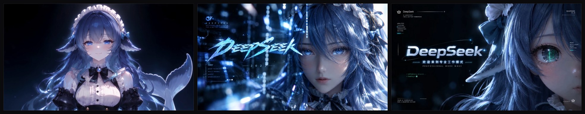

# dsh-custom-splash

给 [DeepSeek Harness](https://github.com/deepseek-ai/deepseek-harness) 加一段开屏动画：**每次启动从三段里随机播放一段**，播完自动淡出。



上图就是随包的三段，从左到右各取一帧：

| 文件 | 时长 | 码率 | 画面 |
|---|---|---|---|
| `assets/stardust.mp4` | 8.06s | 2659 kbps | 闭眼半身特写，柔光星尘 |
| `assets/datastream.mp4` | 7.05s | 2951 kbps | 左侧 DEEPSEEK 大字 + 右侧脸部 + 数据流 |
| `assets/gaze.mp4` | 7.05s | 2106 kbps | 深色字标 + 青色瞳孔特写 |

## 安装

```sh
dsh plugin --profile desktop add github:muning0214/dsh-custom-splash
```

- 桌面版用 `--profile desktop`，Web 版用 `--profile web`
- 装完**完全退出 DSH 再重开**（bundle 在启动时装配）
- 仓库里没有构建产物依赖、也没有 `prepare` / `postinstall` 脚本，`pnpm add` 不会编译任何东西，不会触发构建授权

## 特性

- **随机播放**：上面三段，每次加载（= 每次重启）用 Fisher–Yates 洗牌取一段
- **随时跳过**：`Esc` 或点击画面；播完自动淡出
- **隐藏标题栏按钮**：Windows 右上角那三个按钮是系统画的，CSS 盖不住，这里改成让它们融进画面
- **实时锐化**：SVG `feConvolveMatrix` 补偿低码率源的糊感，可在 `index.mjs` 里调强度
- **绝不卡启动**：素材坏一个自动换下一个；全部失败、解码报错、播放被拒、超过 20 秒，都立刻放行

## 换成你自己的视频

1. 把 mp4 放进 `assets/`
2. 改 `index.mjs` 顶部的 `ASSETS` 表：

```js
const ASSETS = new Map([
  ['stardust.mp4', 'video/mp4'],
  ['datastream.mp4', 'video/mp4'],
  ['gaze.mp4', 'video/mp4']
])
```

加一行就多一段，删一行就少一段。

> 视频需要 **faststart**（`moov` 在 `mdat` 之前），否则浏览器要下完整个文件才能播。
> 修复：`ffmpeg -i in.mp4 -c copy -movflags +faststart out.mp4`

## 可调参数

| 位置 | 作用 | 默认 |
|---|---|---|
| `MAX_HOLD` | 最多遮挡多久（毫秒），兜底放行 | `20000` |
| `fade` | 淡出时长（毫秒） | `420` |
| `kernelMatrix` | 锐化卷积核，中心值越高越锐，超过 3.2 开始出白边 | `2.4 / -0.35` |
| `CAPTION_CSS` | 标题栏按钮透明规则 | 见源码 |

## 实现

只用了宿主的三个公开扩展点，没有改任何打包文件。

**1. 视频路由** — `connection.fetch.register()`

```js
ctx.connection.fetch.register({
  path: '/api/dsh-splash/stardust.mp4',
  methods: ['GET', 'HEAD'],
  requestBody: 'buffered',
  fetch: (request) => serveAsset(request, 'stardust.mp4')
})
```

必须支持 `Range`，否则 Chromium 无法流式解码视频。只读白名单里的文件，路径不可穿越。

**2. 注入播放器** — `webserver/index-inject`

往 `index.html` 的 body 开头注入一段自包含脚本，在应用外壳挂载之前用 Shadow DOM 盖一层全屏 `<video>`。样式与页面完全隔离，卸载时随宿主一起消失。

**3. 隐藏标题栏按钮** — 借用 preload 的色探针

DSH 桌面用 `titleBarStyle: "hidden"` + `titleBarOverlay`，按钮由系统绘制在网页之上，`z-index` 再高也盖不住。但 preload 里有一个隐藏 `span`，其 `background-color` / `color` 被读出来，经 IPC `dsh-desktop:windows-appearance` 交给主进程 `setTitleBarOverlay()`。

preload 监听 `document.head` 的变动，所以注入一条把该探针改成 `transparent` 的 `<style>` 就会自动触发重发：

```css
[data-windows-titlebar] body:has(> #dsh-custom-splash)
  > span[style*="--dsw-specific-sidebar-fill"]{
    background-color: transparent !important;
    color: transparent !important;
}
```

移除这条 `<style>` 时，按钮配色自动还原。

## 已知限制

- **分辨率 1280×720**：这是素材源文件本身的分辨率，不是压缩掉的。1080p 以上的屏幕会放大显示，靠实时锐化补偿
- **码率 2106–2951 kbps**：高于视频平台常见的 720P 档（约 1–1.5 Mbps），但暗场与发丝细节仍有损失
- 只在 **Windows 桌面版**验证过；macOS / Linux 上标题栏处理会跳过，其余功能照常
- 三段的时长不一致（8.06s / 7.05s / 7.05s），所以开屏时长会略有浮动

## 参考

本项目的思路参考了下面两个项目，特此致谢：

- **[Yiheng-guo/dsh-boot-animation-pro](https://github.com/Yiheng-guo/dsh-boot-animation-pro)** —— 功能完整的开屏插件，有播放控制、触发规则、片库管理、画面特效和分时段片头。也是「不动安装包、只走宿主扩展点」这条路线的现成范本
- **[NativeDog1/dsh-boot-animation](https://github.com/NativeDog1/dsh-boot-animation)** —— 上面那个项目的原版，BSD-3-Clause

代码是独立写的，没有基于这两个仓库 fork；参考的是思路与实现路线。

## 素材来源与许可

代码以 **MIT** 发布。

但 `assets/` 里的动画片段**不在此许可范围内**：它们是第三方动画素材，版权归原作者所有，随仓库附带仅用于演示本插件的效果。如需公开分发或商用，请把 `assets/` 替换为你自己拥有权利的素材。

## 卸载

```sh
dsh plugin --profile desktop remove dsh-custom-splash
```
